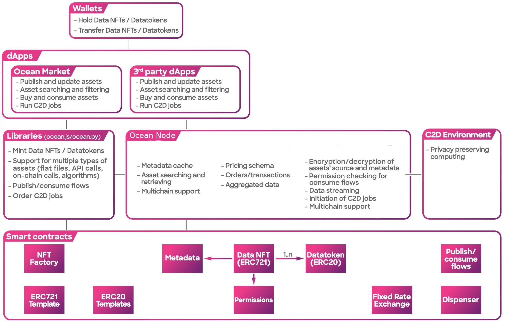

# Architecture Overview

Embark on an exploration of the innovative realm of Ocean Protocol, where data flows seamlessly and AI achieves new heights. Dive into the intricately layered architecture that converges data and services, fostering a harmonious collaboration. Let us delve deep and uncover the profound design of Ocean Protocol.🐬
 
<figure><figcaption>
Overview of the Ocean Protocol Architecture
</figcaption></figure>

### Layer 1: The Foundational Blockchain Layer

At the core of Ocean Protocol lies the robust [Blockchain Layer](contracts/). Powered by blockchain technology, this layer ensures secure and transparent transactions. It forms the bedrock of decentralized trust, where data providers and consumers come together to trade valuable assets.

The smart contracts are deployed on the Ethereum mainnet and other compatible networks. The libraries encapsulate the calls to these smart contracts and provide features like publishing new assets, facilitating consumption, managing pricing, and much more. To explore the contracts in more depth, go ahead to the contracts section.

### Layer 2: The Empowering Middle Layer

Above the smart contracts, you'll find essential [libraries](architecture.md#libraries) employed by applications within the Ocean Protocol ecosystem, the [middleware components](architecture.md#middleware-components), and [Compute-to-Data](architecture.md#compute-to-data).

#### Libraries

These libraries include [Ocean.js](ocean.js), a JavaScript library, and [Ocean.py](../data-scientists/ocean.py), a Python library. They serve as powerful tools for developers, enabling integration and interaction with the protocol.

1. [Ocean.js](ocean.js): Ocean.js is a JavaScript library that serves as a powerful tool for developers looking to integrate their applications with the Ocean Protocol ecosystem. Designed to facilitate interaction with the protocol, Ocean.js provides a comprehensive set of functionalities, including data tokenization, asset management, and smart contract interaction. Ocean.js simplifies the process of implementing data access controls, building dApps, and exploring data sets within a decentralized environment.
2. [Ocean.py](../data-scientists/ocean.py): Ocean.py is a Python library that empowers developers to integrate their applications with the Ocean Protocol ecosystem. With its rich set of functionalities, Ocean.py provides a comprehensive toolkit for interacting with the protocol. Developers and [data scientists](../data-scientists/) can leverage Ocean.py to perform a wide range of tasks, including data tokenization, asset management, and smart contract interactions. This library serves as a bridge between Python and the decentralized world of Ocean Protocol, enabling you to harness the power of decentralized data.

#### Ocean Network

Ocean Network is the peer-to-peer GPU cloud that sits on top of Ocean Nodes. It connects people with idle GPUs to the developers and data scientists who need that compute, and it settles every job through an escrow contract on Base (Ethereum L2). The result is one global pool of GPUs that anyone can rent and anyone can contribute to.

**How a job flows through Ocean Network:**

1. **Pick what to run and where:** On the [Ocean Network dashboard](https://dashboard.oncompute.ai), choose your workload and a compute environment, and filter nodes for the exact specs you need, such as an NVIDIA H200. For Ocean Inference, the workload is a curated model, a Hugging Face model, a service, or a template. For a compute job, it's your algorithm. The dashboard shows the node, time, and estimated cost before you commit.
2. **Lock funds in escrow.** Payment goes into an escrow contract on Base for the runtime you book.
3. **Run the workload.** What happens next depends on the workload:
   * **Ocean Inference:** The node operator claims the booked session window, then the node starts your model or app as a container on its GPU. You get a live HTTP endpoint, which for models is OpenAI-compatible, for as long as the session is booked. While it runs, you can call the endpoint, watch the logs, extend the paid window, and change the model or configuration in place.
   * **Compute job:** The node runs your algorithm once and exits. You can launch it from the dashboard, from your editor with Ocean Orchestrator, from the Ocean CLI, or from an AI agent/ claude through the ON MCP server.
4. **Get the result.** Inference gives you the live endpoint. A compute job gives you its output.
5. **Release payment.** Funds are released to the node operator once the job completes successfully.

**The main components:**

* **Ocean Nodes (supply):** Node operators run the Ocean Node software on their hardware and earn rewards. Benchmark jobs measure node performance, and operators compete on leaderboards. See Ocean Nodes below.
* **Escrow on Base (payments):** Settlement is on-chain, with low fees and fast confirmation. For Inference, the node operator claims the booked session window before the container starts.
* **Ocean Network dashboard (catalog and control):** A visual interface to find compute, launch jobs and services, and manage a node's performance, incentives, and connectivity. It includes wallet setup and a fiat on-ramp. [Learn more](https://docs.oncompute.ai/ocean-network-dashboard/running-compute-jobs-on-ocean-nodes-dashboard)
* **Ocean Inference (long-running services):** Keeps a model or AI app running on a node's GPU, reachable over HTTP. Launch a curated model, any Hugging Face model, a ready-made service, or a template. [Learn more](https://docs.oncompute.ai/inference/overview)
* **Ocean Orchestrator (jobs from your editor):** Run GPU jobs from VS Code, Cursor, or Windsurf with a one-click workflow, using the compute environment you selected on the dashboard. Compute-to-Data is built in. [Learn more](https://docs.oncompute.ai/ocean-orchestrator/overview)
* **Ocean CLI (terminal access):** Publish datasets and algorithms, consume them, and run compute jobs from the command line. [Learn more](https://docs.oncompute.ai/ocean-cli/markdown)
* **ON MCP server (agent access):** Exposes around 80 tools over the Model Context Protocol, so any AI agent can drive compute jobs. [Learn more](https://docs.oncompute.ai/on-mcp/quickstart)
* **Persistent Storage (data):** Store data once in a bucket and mount it into any container that needs it. It works with the CLI, the dashboard, and Ocean Orchestrator. [Learn more](https://docs.oncompute.ai/persistent-storage/quickstart)

Ocean Node is a single component which runs all core middleware services within the Ocean Network stack. It replaces the roles of Aquarius, Provider and the Subgraph. It integrates the Indexer for metadata management and the Provider for secure data access. It ensures efficient and reliable interactions within the Ocean Protocol network.

Ocean Nodes handles network communication through libp2p, supports secure data handling, and enables flexible compute-to-data operations.&#x20;

The functions of Ocean nodes include:

* It is crucial in handling the asset downloads, it streams the purchased data directly to the buyer.
* It conducts the permission an access checks during the consume flow.&#x20;
* The Node handles [new DDO structure](https://docs.oceanprotocol.com/developers/new-ddo-specification) (Decentralized Data Object) encryption, but it offers support for [existing DDO format](https://docs.oceanprotocol.com/developers/ddo-specification).
* It establishes communication with the operator-service for initiating Compute-to-Data jobs.
* It provides a metadata cache, enhancing search efficiency by caching on-chain data into a Typesense database. This enables faster and more efficient data discovery.
* It supports multiple chains.

#### Old components

Previously Ocean used the following middleware components:

1. [Aquarius](old-infrastructure/aquarius/)
2. [Provider](old-infrastructure/provider/)
3. [Subgraph](old-infrastructure/subgraph/)

#### Compute-to-Data

[Compute-to-Data](compute-to-data/) (C2D) represents a groundbreaking paradigm within the Ocean Protocol ecosystem, revolutionizing the way data is processed and analyzed. With C2D, the traditional approach of moving data to the computation is inverted, ensuring privacy and security. Instead, algorithms are securely transported to the data sources, enabling computation to be performed locally, without the need to expose sensitive data. This innovative framework facilitates collaborative data analysis while preserving data privacy, making it ideal for scenarios where data owners want to retain control over their valuable assets. C2D provides a powerful tool for enabling secure and privacy-preserving data analysis and encourages collaboration among data providers, ensuring the utilization of valuable data resources while maintaining strict privacy protocols.

