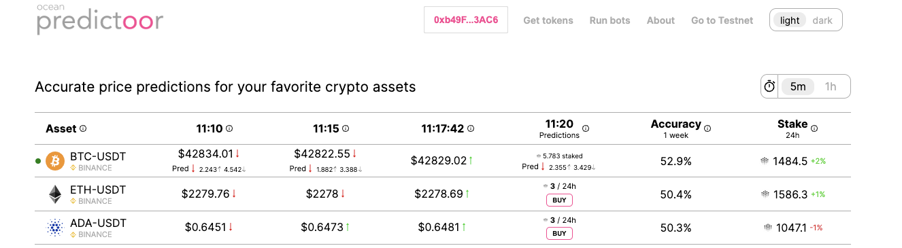

# What can you do with Ocean?

This page shows things you can do with Ocean...

* As a builder
* As Ocean Node runner
* Become an Ocean ambassador

Let's explore each...

## What Ocean holders can do 

Information related to Ocean Token

To learn more about Ocean Token, refer to this [page](https://oceanprotocol.com/about-us/ocean-token)

## What builders can do

Builders can rent GPUs on [Ocean Network](https://docs.oncompute.ai/), serve models, launch AI apps, and run jobs from their own tools.

Serve an Open-Source Model

Run any model on the Hugging Face Hub on a node's GPU and get a live endpoint you can call over HTTP, with an OpenAI-compatible API. Choose a [Curated Model](https://dashboard.oncompute.ai/inference/default-models) for a pre-sized package with a tested engine preset, or a [Custom Model](https://dashboard.oncompute.ai/inference/custom-models) for full control over the launch settings. You pay for the runtime you book, and Ocean Network handles placement, payment, and lifecycle.

Learn more [here](https://docs.oncompute.ai/inference/overview).

Launch an AI App or Template

Start a ready-made app such as ComfyUI, Open WebUI, or JupyterLab on a node's GPU with [Services](https://dashboard.oncompute.ai/inference/services), and add your own models from inside the app. Or launch a [Template](https://docs.oncompute.ai/inference/templates), an app that ships with its models and workflows already inside. Pick the outcome you want, such as text to image, image to video, or agentic development, and you're running in minutes.

Follow the [template tutorials](https://docs.oncompute.ai/inference-tutorials/quickstart) for step-by-step guides.

Manage Your Running Service

Once your model or app is live, call your endpoint, watch the logs, extend the paid window, and change the model or configuration in place without losing the service.

Learn more [here](https://docs.oncompute.ai/inference/managing-a-running-service).

Run Jobs From Your Editor With Ocean Orchestrator

Take the compute environment you selected on the Ocean Network dashboard straight into VS Code, Cursor, or Windsurf, and run your training jobs from there with a one-click workflow and pay-per-use pricing.

Learn more [here](https://docs.oncompute.ai/ocean-orchestrator/overview).

Build With the Ocean CLI

Publish datasets and algorithms, run compute jobs, and orchestrate complex compute flows from your terminal with the Ocean CLI.

Learn more [here](https://docs.oncompute.ai/ocean-cli/markdown).

Drive Compute From Your AI Agents

Connect any AI agent to Ocean Network through the ON MCP server, which exposes around 80 tools over the Model Context Protocol. Your agent can write and validate an algorithm and run free and paid compute jobs.

Learn more [here](https://docs.oncompute.ai/on-mcp/quickstart).

Store Your Data Once With Persistent Storage

Upload your data to a bucket once and mount it into any container that needs it, instead of uploading it again for every job. It works with the Ocean CLI, the Ocean Network dashboard, and Ocean Orchestrator.

Learn more [here](https://docs.oncompute.ai/persistent-storage/quickstart).

Run Real Workloads on Ocean Network

Fine-tune language models with LoRA and PEFT, run an autonomous ML research agent on a single H200 GPU, build data preprocessing and analysis pipelines, and more, without managing a server or a cloud account.

Browse the [use cases](https://docs.oncompute.ai/use-cases/quickstart).

Build Your Token-gated AI dApp

Monetize by making your dApp token-gated. Users no longer have to use credit cards or manage OAuth credentials. Rather, they buy & spend ERC20 datatokens to access your dApp content.

Go further yet: rather than storing user profile data on your centralized server -- which exposes you to liability -- have it on-chain encrypted by the user's wallet, and just-in-time decrypt for the app.

Build Your Token-gated REST API

Focus on the backend: make a Web3-native REST API. Like the token-gated dApps, consumers of the REST API buy access with crypto, not credit cards.

Build Your Data Market

Build a decentralized data marketplace by [forking Ocean Market code](../developers/build-a-marketplace/) to quickly get something good, or by building up from Ocean components for a more custom look.

## What data scientists can do

<figure><figcaption></figcaption></figure>

Use Ocean in Python

The [**ocean.py**](../data-scientists/ocean.py/) library is built for the key environment of data scientists: Python. Use it to earn $ from your data, share your data, get more data from others, and see provenance of data usage.

Do crypto price predictions

With [Ocean Predictoor](../predictoor/), you submit predictions for the future price of BTC, ETH etc, and earn. The more accurate your predictions, the more $ you can earn.

## What Ocean Node runners can do 

Monetize your computing hardware

You can monetize any machine with idle compute power, from personal laptops and gaming PCs to high-performance servers and cloud instances, by connecting them to Ocean Nodes. These machines contribute unused CPU or GPU resources to a decentralized compute network, earning rewards for AI training, inference, or data processing.
  

## Become an Ocean Ambassador

Become an Ambassador

As an ambassador, you are an advocate for the protocol, promoting its vision and mission. By sharing your knowledge and enthusiasm, you can educate others about the benefits of Ocean Protocol, inspiring them to join the ecosystem. As part of a global community of like-minded individuals, you gain access to exclusive resources, networking opportunities, and collaborations that further enhance your expertise in the data economy. Of course, the Ocean Protocol Ambassador Program rewards contributors with weekly bounties and discretionary grants for growing the Ocean Protocol communtiy worldwide.

Follow the steps below to become an ambassador:

To become a member of the Ambassador Program, follow these steps:

1. Join Ocean Protocol's [Discord](https://discord.com/invite/TnXjkR5) server
2. Join the Discord channel called #treasure-hunter.
3. Access the application form: "[Apply](https://discord.com/channels/612953348487905282/1133478278531911790) to use this channel."
4. Answer the questions in the application form.
5. Once you've completed the application process, you can start earning experience points (XP) by actively engaging in discussions on various topics related to the Ocean Protocol.

***

_Next:_ [_OCEAN: The Ocean token_](ocean-token.md)

_Back:_ [_What is Ocean?_](what-is-ocean.md)
