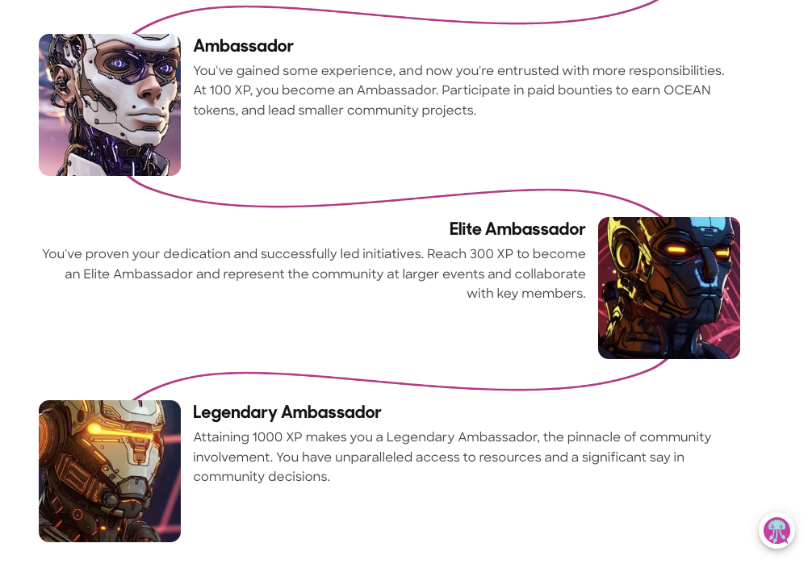

## What is Ocean?

Ocean is a decentralized data and compute protocol.

AI lives on data and compute, Ocean Network is where you can rent compute environment and run open-source models in minutes.

Ocean has two specific parts:
- A live tech stack. At the core is [Ocean Network](https://dashboard.oncompute.ai/) which brings together **Ocean Inference**, **Templates**, **Ocean Orchestrator**, and **Ocean Nodes**.
- A lively community. This includes **builders, AI enthusiasts**, and **Ocean Ambassadors**. Ocean's community is active on **social media**.

Let's drill into each.

## Tech: Ocean Network

Ocean Network is a decentralized GPU network. Nodes around the world contribute idle GPUs, and users rent them to run open-source models for AI inference, training, and data processing. Ocean Network is deployed on Base, so transactions are fast and low-fee.

Developers and data scientists browse a catalog of compute resources, filter for the exact specs they need, and pay for the hours they use. Node operators monetize their hardware and earn rewards.

Start on the [Ocean Network dashboard](https://dashboard.oncompute.ai/), or read the Ocean Network [docs](https://docs.oncompute.ai/). Let's explore more:

1) [Ocean Inference](https://dashboard.oncompute.ai/inference): Ocean Inference runs open models and AI apps on real GPUs from the dashboard. You pick what to run, pay for the hours you need, and get a live endpoint.

a) [Curated Models](https://dashboard.oncompute.ai/inference/default-models): Pre-sized packages that pair a model with a tested engine preset and the hardware it needs.

b) [Custom Models](https://dashboard.oncompute.ai/inference/custom-models): Serve any model on the Hugging Face Hub with full control over the launch settings.

c) [Services](https://dashboard.oncompute.ai/inference/services): Ready-made apps such as ComfyUI, Open WebUI, and JupyterLab, running on a node's GPU

d) Templates: See below

2) [Templates](https://dashboard.oncompute.ai/inference/templates): Templates are ready-to-use apps with their models and workflows already inside. Pick the outcome you want, such as text-to-video, reference-to-video, image-to-video, music generation, Ad studio or agentic development, and launch it.

Choose a template and a compute environment, and Ocean Network shows you the node, time, and cost before you run. Follow the step-by-step template [tutorials](https://docs.oncompute.ai/inference-tutorials/quickstart) to see what each template produces.

3) [Ocean orchestrator](https://open-vsx.org/extension/OceanProtocol/ocean-protocol-vscode-extension): Ocean Orchestrator lets you run affordable GPU AI jobs from your editor with a one-click workflow and pay-per-use pricing.

Bring the compute environment you selected on the [dashboard](https://dashboard.oncompute.ai/run-job/environments) straight into VS Code, Cursor, or Windsurf, and run your training jobs from there. Compute-to-Data is built in, so algorithms travel to private data and jobs run in isolated containers. Only the results are visible to the consumer, which lets companies monetize private data assets and share data for science or technology use cases with lower liability risk.

## Community: Ocean Ambassadors

Ocean has an excellent [community of ambassadors](https://oceanprotocol.com/explore/community). Anyone can join.

<figure></figure>

## Community: Social Media

Follow Ocean Protocol on [X](https://twitter.com/OceanProtocol), Ocean Network on [X](https://x.com/ONcompute) or [Telegram](https://t.me/oceanprotocol_community) to keep up to date. Chat directly with the Ocean community on [Discord](https://discord.gg/TnXjkR5). Or, track Ocean progress directly on [GitHub](https://github.com/oceanprotocol).

Finally, the [Ocean blog](https://blog.oceanprotocol.com/) has regular updates.

----

_Next: [What can you do with Ocean?](benefits.md)_

_Back: [Why Ocean?](why-ocean.md)_
